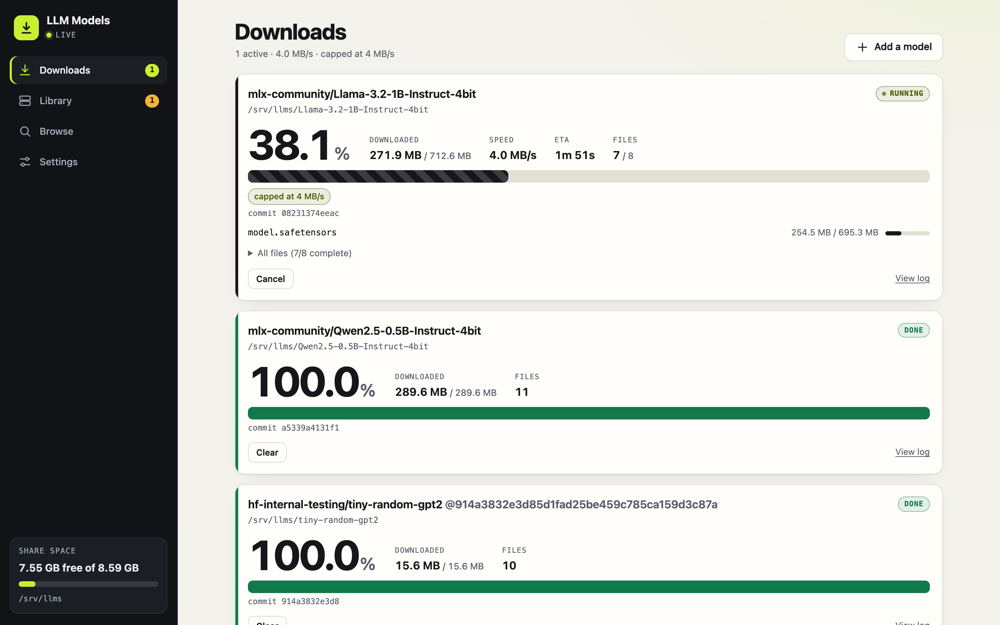
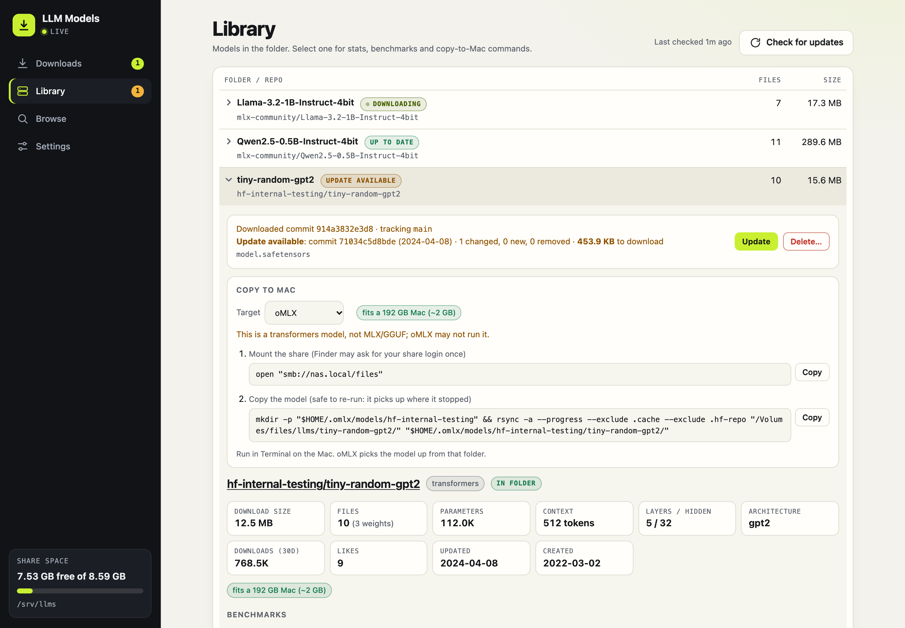
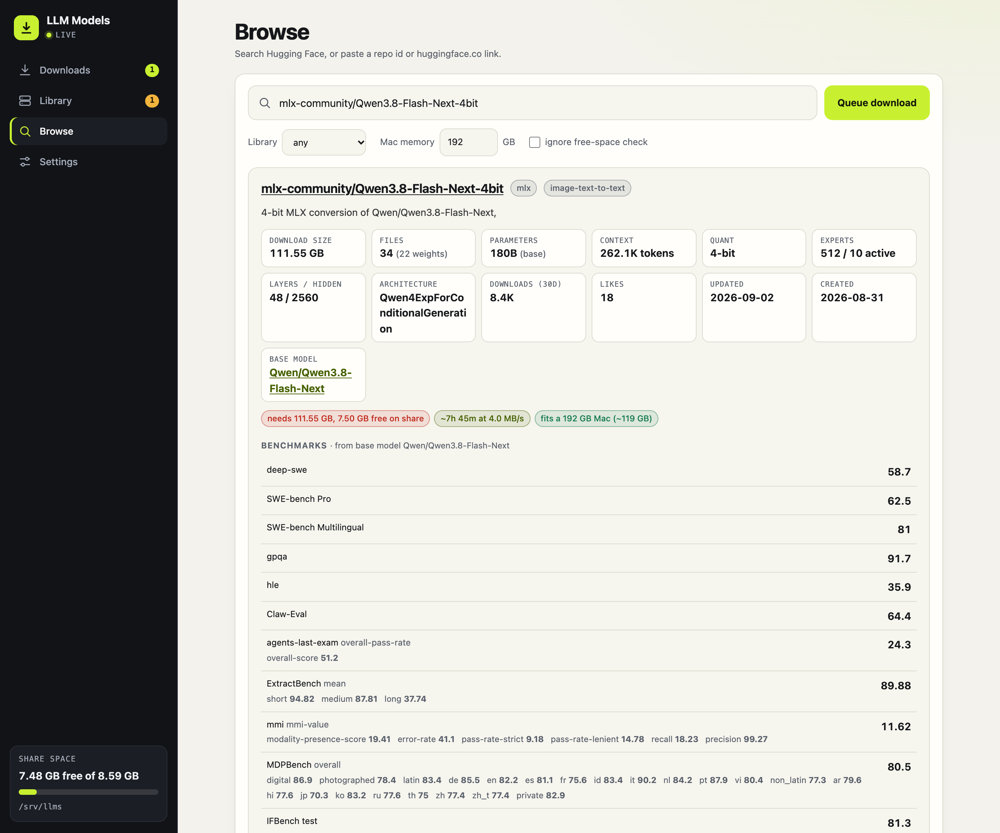

# llm-manager

**A self-hosted web app for downloading Hugging Face models to a NAS and getting them onto your Mac.**

Point it at a folder on your NAS, paste a Hugging Face repo, and watch a 100 GB model arrive. Each
file is checked against the hash Hugging Face publishes, and downloads resume after interruptions.
Then send the model to [oMLX](https://github.com/jundot/omlx) or [LM Studio](https://lmstudio.ai)
on your Mac with one click, and watch it arrive and get verified.



- **Browse before you download.** Search Hugging Face as you type, or paste a repo id or link to see
  size, parameters, context length, experts and quantization. Badges show whether the model fits on
  your share and in your Mac's memory, and the card shows its benchmarks.
- **Downloads that survive anything.** Each file streams into a partial file and resumes with HTTP
  Range requests after a restart, reboot or network drop. Every file is verified against the
  Hugging Face SHA-256 before it's moved into place, and a download stays on one commit.
- **Live progress.** Overall and per-file bytes, speed and ETA, updated every 2 seconds.
- **Model cards.** Every model in the Library gets a card with generated art (its own gradient
  and pattern, tinted by model family), its quant, size and the release commit it came from.
- **Library.** Lists every model in the folder with update checks. Updates re-download only the
  files that changed. Deleting a model requires typing its name.
- **Send to Mac.** One click copies a model from the share into oMLX, LM Studio or any folder on
  your Mac over SSH with `rsync`, with live progress, speed and ETA. Interrupted copies resume,
  and every file's size is checked against the share when it's done. Ready-to-paste commands are
  still there if you'd rather run the copy yourself.
- **Speed control.** A global speed cap, plus quiet hours that lower the cap or pause downloads
  during a daily window.
- **Gated models.** A Hugging Face token can be saved; it's checked with Hugging Face before saving
  and never shown again.
- **Safe on your LAN.** An IP allowlist plus a password login, hashed session cookies and a strict
  CSP. The UI makes no third-party requests.
- **Small.** Python standard library plus `huggingface_hub`. The UI is two self-contained HTML
  files with no build step.

| Library: update status and Send to Mac | Browse: model card with benchmarks |
|---|---|
|  |  |

---

## Contents
- [Quick start (try it locally)](#quick-start-try-it-locally)
- [Install on a Linux server](#install-on-a-linux-server)
- [Install in a Proxmox LXC](#install-in-a-proxmox-lxc)
- [Configuration](#configuration)
- [CI/CD](#cicd)
- [Using it](#using-it)
- [CLI](#cli)
- [How it works](#how-it-works)
- [HTTP API](#http-api)
- [Security](#security)
- [Troubleshooting](#troubleshooting)
- [Limitations](#limitations)
- [Contributing](#contributing)
- [License](#license)

## Requirements
- **Server:** Linux with **Python 3.11+** and systemd. It's developed on Debian 13 (Python 3.13).
  The models folder can be anywhere the service can write; it's usually a NAS share mounted on
  the server or bind-mounted into a container.
- **Python package:** `huggingface_hub` (see `requirements.txt`).
- **Optional:** Proxmox VE, if you use `deploy.sh`. For Send to Mac: `openssh-client` and `rsync`
  on the server, and Remote Login (SSH) turned on on the Mac. For the copy-it-yourself commands, a
  Mac with SMB access to the same share.

---

## Quick start (try it locally)
To try it on your own machine (macOS or Linux), with no login and only reachable from this
machine:

```bash
python3 -m venv .venv && .venv/bin/pip install -r requirements.txt
LLM_AUTH=off ALLOWED_NETS=127.0.0.0/8 LLM_DIR=./models STATE_DIR=./state .venv/bin/python server.py
```
Then open http://localhost:8080 and paste a small model, e.g. `mlx-community/Qwen2.5-0.5B-Instruct-4bit`.

> `LLM_AUTH=off` is for trying it out only. A real install uses the password login below.

---

## Install on a Linux server

1. **Pick a service user** that can write to the models folder. If the folder is on a NAS share,
   use the user and group that own it, so files keep the right ownership:
   ```bash
   sudo useradd --system --create-home --shell /usr/sbin/nologin llm   # or reuse an existing user
   sudo install -d -o llm -g llm /mnt/files/llms
   ```
2. **Install the app** into `/opt/llm-manager`:
   ```bash
   sudo install -d /opt/llm-manager/web /etc/llm-manager
   sudo apt install openssh-client rsync   # for Send to Mac
   sudo cp server.py downloader.py hfinfo.py quants.py auth.py transfer.py /opt/llm-manager/
   sudo cp web/index.html web/login.html /opt/llm-manager/web/
   sudo python3 -m venv /opt/llm-manager/venv
   sudo /opt/llm-manager/venv/bin/pip install -r requirements.txt
   sudo install -m 755 llm-manager /usr/local/bin/llm-manager
   ```
3. **Configure** it: copy `env.example` and edit it (see [Configuration](#configuration)):
   ```bash
   sudo install -m 600 env.example /etc/llm-manager/env
   sudo chmod 700 /etc/llm-manager
   sudoedit /etc/llm-manager/env          # set RUN_USER=llm, MAC_SMB_URL, ...
   ```
4. **Run it with systemd.** Edit `User=`, `Group=` and `RequiresMountsFor=` in
   `llm-manager.service` to match your setup, then:
   ```bash
   sudo cp llm-manager.service /etc/systemd/system/
   sudo systemctl daemon-reload && sudo systemctl enable --now llm-manager
   ```
5. **Set the password.** It's required: the UI shows nothing until one exists.
   ```bash
   sudo llm-manager passwd
   ```
   Open `http://<server>:8080` and sign in.

## Install in a Proxmox LXC
`deploy.sh` pushes the app into a container from your workstation using `pct`. This is the setup
the project was built for: a small unprivileged LXC with the NAS dataset bind-mounted.

1. **Create the container** on the Proxmox host. Use any Debian 12/13 template:
   ```bash
   pct create <ctid> local:vztmpl/debian-13-standard_13.1-2_amd64.tar.zst \
     --hostname llm-manager --unprivileged 1 --features nesting=1 \
     --cores 2 --memory 1024 --swap 512 --rootfs <storage>:8 \
     --mp0 /<pool>/<dataset>,mp=/mnt/files,backup=0 \
     --net0 name=eth0,bridge=<bridge>,ip=<ct-ip>/24,gw=<gateway>,type=veth \
     --onboot 1
   pct start <ctid>
   ```
2. **Share permissions.** In an unprivileged LXC, a container uid/gid of N maps to 100000+N on the
   host. Create a container user whose mapped ids own the dataset, and set `User=` / `Group=` in
   `llm-manager.service` and `RUN_USER` in the env file to match. The defaults are `nas` /
   `nas_shares`.
   ```bash
   pct exec <ctid> -- groupadd -g <gid> <group>
   pct exec <ctid> -- useradd -u <uid> -g <gid> -m <user>
   pct exec <ctid> -- su <user> -s /bin/sh -c 'mkdir -p /mnt/files/llms'
   ```
3. **Deploy** from this folder on your workstation. This needs root SSH access to the Proxmox node:
   ```bash
   PXE_HOST=<proxmox-ssh-host> CTID=<ctid> ./deploy.sh --bootstrap   # first time: venv + deps
   ```
   The first run creates `/etc/llm-manager/env` from `env.example`. Edit it, then deploy again
   without `--bootstrap`. Use the same command for later updates; running downloads resume after
   the restart.
4. **Set the password.** `-t` gives the prompt a terminal, so your input stays hidden:
   ```bash
   ssh -t <proxmox-ssh-host> pct exec <ctid> -- llm-manager passwd
   ```

> Type the password only at the hidden prompt. Never pass it as a command argument, because it
> would end up in your shell history.

---

## Configuration
Settings live in `/etc/llm-manager/env` (root-only); see `env.example`. No secrets go there. The
password hash and the Hugging Face token are stored under `STATE_DIR` with mode 0600.

| Variable | Default | Meaning |
|---|---|---|
| `LLM_DIR` | `/mnt/files/llms` | Where models are downloaded |
| `STATE_DIR` | `/var/lib/llm-manager` | Jobs, logs, settings, sessions, password hash, token |
| `PORT` | `8080` | Web UI port |
| `MIN_FREE_GB` | `10` | Refuse downloads that would leave less free space |
| `UPDATE_CHECK_HOURS` | `6` | Background update-check interval |
| `ALLOWED_NETS` | private ranges + `100.64.0.0/10` | Client CIDRs allowed to connect |
| `MAC_SSH_HOST`, `MAC_SSH_USER`, `MAC_SSH_PORT` | *(empty)*, *(empty)*, `22` | The Mac to send models to. Defaults for **Settings → Send to Mac**, which overrides them |
| `MAC_TRANSFER_MODE` | `push` | `push`: this server streams to the Mac. `pull`: the Mac reads the share itself (see [Send to Mac](#send-to-mac)) |
| `MAC_NAS_PATH` | *(empty)* | Pull mode: where `LLM_DIR` is mounted on the Mac, e.g. `/Volumes/llms` |
| `MAC_RSYNC` | `rsync` | rsync on the Mac, e.g. `/opt/homebrew/bin/rsync` |
| `MAC_OMLX_DIR`, `MAC_LMSTUDIO_DIR` | `~/.omlx/models`, `~/.lmstudio/models` | Model folders on the Mac |
| `MAC_SSH_KEY` | `STATE_DIR/ssh/id_ed25519` | Private key used to reach the Mac. Generated on first use when unset |
| `MAC_SMB_URL` | *(empty)* | e.g. `smb://nas.local/files`, used in the copy-it-yourself commands |
| `MAC_MOUNT` | `/Volumes/files` | Where that share appears on the Mac |
| `LLM_SUBDIR` | name of `LLM_DIR` | Path of `LLM_DIR` inside the share |
| `CTID` | | Container id, shown on the "set a password first" page |
| `RUN_USER` | `nas` | User the CLI switches to (match the unit's `User=`) |
| `HF_HOME` | `STATE_DIR/hf-home` | `huggingface_hub`'s cache/config folder, kept out of `/home` because the unit uses `ProtectHome=yes` |
| `LLM_AUTH` | `on` | `off` disables the login. **For local testing only**; the allowlist still applies |

Settings changed in the UI (speed cap, quiet hours, token, Mac connection) are stored in
`STATE_DIR` and take effect immediately.

---

## CI/CD
Pull requests run tests on GitHub; a merge to `main` deploys to the container through a self-hosted
runner inside it, with an automatic rollback if the service doesn't come up. See [docs/CI.md](docs/CI.md).

## Using it

### Browse and download
In **Browse**, type:
- **Free text** searches Hugging Face, sorted by downloads. Use the Library filter (MLX, GGUF,
  Transformers) to narrow it.
- **A repo id** (`org/name`) or a **huggingface.co link** opens the model card. A link to a branch
  or commit (`…/tree/<rev>`) downloads that revision.

The model card shows size, files, parameters, context length, quantization, experts, the
base-model chain, license, downloads and likes. Badges show:
- whether it fits on the share (keeping `MIN_FREE_GB` spare)
- the estimated download time
- whether it fits in your Mac's memory (set **Mac memory** once; it's remembered in your browser)

**Pick a quant (GGUF repos).** Repos such as `unsloth/…-GGUF` or `bartowski/…-GGUF` hold many
quants of one model (Q2_K … Q8_0, BF16). The card lists them with their sizes and downloads only
the one you pick, plus the shared files (README, config, and one vision projector if the model has
one). It preselects **Q4_K_M** (or the nearest 4-bit quant); with **Mac memory** set and that quant
too big, it picks the largest quant that fits. Download size, time and the fit badges follow the
quant you pick. Each quant gets its own folder (`<name>-<QUANT>`), so you can keep several side by
side, and update checks only look at that quant's files. MLX and Transformers repos hold one
quantization per repo and are downloaded whole, as before.

**Benchmarks** come from the eval results the repo publishes on Hugging Face. Quantized repos
rarely have their own, so the app follows the `base_model` chain and labels where the scores came
from. Markdown tables from the model card, such as a quant's quality tables, appear under "Card
table". Scores are self-reported by the model authors unless marked *verified*.

### Downloads
One download runs at a time, with 4 files in parallel. Each card shows overall percent, bytes,
speed, ETA and files done, the files in flight, and an "All files" list.
- **Cancel** keeps partial files, and **Resume** continues from them.
- **View log** shows resumes, retries and verification.
- A download blocked for lack of space can be resumed with **ignore space check**.

### Library: updates and delete
Expand a model to see:
- **The commit you downloaded and whether it's current.** **Check for updates** (or the background
  check) compares it with the Hub and shows changed, new and removed files and how much to
  download.
- **Update** downloads only the changed files. The old copy stays usable until each new file is
  swapped in. A download pinned to a commit follows `main`; one pinned to a branch or tag follows
  that branch or tag.
- **Delete…** permanently removes the model folder. You must type the folder name, and it's
  refused while that model is downloading.

### Send to Mac
Expand a model in the Library, pick a target and press **Send to Mac**. The copy shows up at the
top of **Downloads** with bytes on the Mac, speed, ETA and the number of files. When rsync is done,
every file's size on the Mac is compared with the share; the card says **verified**, or lists the
files that differ and offers **Resume**. One copy runs at a time; more wait in the queue.

**Set it up once** in **Settings → Send to Mac**:
1. Enter the Mac's host or IP and your Mac login name.
2. Turn on Remote Login on the Mac (System Settings → General → Sharing).
3. Copy the command under **This server's SSH key** and run it in Terminal on the Mac. It adds the
   server's own key (generated on first use, kept in `STATE_DIR/ssh`, never shown) to
   `~/.ssh/authorized_keys`.
4. Press **Test connection**. It signs in, finds rsync and, in pull mode, checks the share is
   mounted. The Mac's host key is remembered on first connect (`STATE_DIR/ssh/known_hosts`).

**How the bytes travel** (also in Settings):
- **This server streams to the Mac** (`push`, the default). The server runs `rsync -a --partial`
  over SSH. Nothing to mount on the Mac. If the network drops, rsync retries (3 attempts, then the
  card offers **Resume**); a service restart re-queues the copy and it carries on from the partial
  files.
- **The Mac reads the share itself** (`pull`). The server starts a small script on the Mac with
  `nohup`, which runs rsync from the share mounted on the Mac (set **Models share on the Mac**, e.g.
  a read-only NFS mount of the models folder) and retries up to 5 times. The copy keeps going if
  the server restarts or loses the connection: the server re-attaches and keeps tracking it. Its
  script and log live in `~/.llm-manager/transfers/<id>/` on the Mac. Mounting the share on the
  Mac is up to you; until it's mounted, the copy fails with a message saying so.

**Cancel** stops rsync (on the Mac, in pull mode) and keeps what was copied; **Resume** continues.
**View log** shows each rsync attempt, the Mac-side log in pull mode, and the verification result.

### Copy it yourself
Under **Or copy it yourself in Terminal** (or directly, when Send to Mac isn't set up), pick a
target:

| Target | Folder |
|---|---|
| **oMLX** | `~/.omlx/models/<org>/<name>` |
| **LM Studio** | `~/.lmstudio/models/<org>/<name>` |
| **Custom folder** | `<your folder>/<name>` |

Then run the two commands in Terminal on the Mac:
```bash
open "smb://nas.local/files"
mkdir -p "$HOME/.omlx/models/<org>" && rsync -a --progress --exclude .cache --exclude .hf-repo \
  "/Volumes/files/llms/<name>/" "$HOME/.omlx/models/<org>/<name>/"
```
Paths are shell-quoted. The panel warns you when the download isn't finished, when you pick LM
Studio for an oMLX-only (oQ) checkpoint, or when the model isn't MLX or GGUF.

### Speed cap and quiet hours (Settings)
- **Speed cap** is a global MB/s limit shared by all parallel files. 0 means unlimited.
- **Quiet hours** is a daily window (it can wrap past midnight) during which downloads are either
  capped at a separate rate or **paused**. A paused download drops its connection and resumes with
  a Range request when the window ends.

---

## CLI
Installed as `llm-manager`. It runs as the service user with the service's settings.
```
llm-manager passwd        set or change the UI password (signs everyone out)
llm-manager set-token     save a Hugging Face token (verified with Hugging Face first)
llm-manager clear-token   remove the saved token
llm-manager status        password/token state (no secrets), speed settings, allowlist
```
The running service picks up changes within a few seconds.

---

## How it works

| File | Role |
|---|---|
| `server.py` | HTTP server (stdlib), job queue, progress monitor, update checks, settings, CLI |
| `downloader.py` | Resumable, hash-verified downloader with a shared speed limiter |
| `hfinfo.py` | Hugging Face metadata for search, model cards and benchmarks (cached) |
| `auth.py` | IP allowlist, password hash, sessions, login throttling |
| `transfer.py` | Send to Mac: rsync over SSH (push, or detached on the Mac in pull mode), progress, verification |
| `web/index.html`, `web/login.html` | The UI: vanilla JS, no external requests |
| `llm-manager` | CLI wrapper |
| `llm-manager.service` | systemd unit (sandboxed: `ProtectSystem`, `ProtectHome`, `NoNewPrivileges`) |
| `env.example` | Every setting, documented |
| `deploy.sh` | Pushes the app into a Proxmox LXC and restarts it |

**Why not `hf download`?** Recent `huggingface_hub` versions download each file into a randomly
named temp file and delete it when a download fails, so an interrupted 5 GB shard starts again from
zero. `downloader.py` streams each file into `<model>/.cache/llm-manager/<file>.part` instead. It
resumes with HTTP Range requests, hashes as it goes (SHA-256 for LFS files, git blob SHA-1
otherwise), and only renames the file into place when the hash matches. `huggingface_hub` is used
only to list repo files.

### Files on disk
| Path | Contents |
|---|---|
| `LLM_DIR/<name>/` | The model files |
| `LLM_DIR/<name>/.hf-repo` | Repo id, downloaded commit, requested revision |
| `LLM_DIR/<name>/.cache/llm-manager/` | `*.part` partial downloads; `verified-<commit>.txt` |
| `STATE_DIR/jobs.json`, `logs/<job>.log` | Download queue, history and per-download logs |
| `STATE_DIR/settings.json` | Speed cap and quiet hours |
| `STATE_DIR/auth.json`, `sessions.json`, `hf_token` | Password hash, session hashes, token (all 0600) |
| `STATE_DIR/actions.log` | Deletions |
| `STATE_DIR/transfers.json`, `mac.json`, `logs/mac-<id>.log` | Send to Mac queue, connection settings, per-copy logs |
| `STATE_DIR/ssh/` | The server's SSH key for the Mac and the Mac's remembered host key |

---

## HTTP API
Every endpoint needs a session cookie (from `POST /api/login`), except `/login`, `/api/login` and
`/favicon.ico`. POST bodies must be `application/json`.

| Method and path | Purpose |
|---|---|
| `GET /api/state` | Jobs with live progress, transfers to the Mac, models with update status, disk, throttle, Mac config |
| `GET /api/preview?q=&lib=` | Search results, or a model card with stats and benchmarks |
| `POST /api/jobs` `{repo, variant?, force?, update?, name?}` | Queue a download (`variant`: one quant of a GGUF repo) or an update (`name`: the Library folder) |
| `POST /api/jobs/<id>/cancel` \| `retry` `{force?}` \| `remove` | Job actions |
| `GET /api/jobs/<id>/log` | Job log (text) |
| `POST /api/updates/check` | Start an update check |
| `POST /api/models/delete` `{name, confirm}` | Delete a model folder (`confirm` must equal `name`) |
| `GET /api/settings` | Speed settings, current throttle, token status (never the token) |
| `POST /api/settings/speed` | `{limit_mbps, quiet:{enabled,start,end,mode,limit_mbps}}` |
| `POST /api/settings/token` `{token}` / `POST /api/settings/token/clear` | Set or remove the token |
| `POST /api/settings/mac` `{host, user, port, mode, mac_source, rsync, omlx_dir, lmstudio_dir}` | Save the Mac connection (`GET /api/settings` returns it with the public key) |
| `POST /api/mac/test` | Sign in to the Mac and check rsync and, in pull mode, the share |
| `POST /api/transfers` `{name, target, custom?}` | Send a Library folder to the Mac (`target`: `omlx`, `lmstudio` or `custom` with `custom` the parent folder) |
| `POST /api/transfers/<id>/cancel` \| `retry` \| `remove`, `GET /api/transfers/<id>/log` | Transfer actions and log |
| `POST /api/login` `{password}` / `POST /api/logout` | Sessions |

---

## Security
- **Reachability.** Run it on a LAN or tailnet. The allowlist (`ALLOWED_NETS`) rejects other
  client addresses. It has no TLS of its own, so to reach it remotely use Tailscale or a TLS
  reverse proxy, never a forwarded port. Behind a proxy, the allowlist sees the proxy's address.
- **Password.** Stored as PBKDF2-SHA256 (600k iterations), and settable only from the CLI. Login
  locks for 5 minutes after 5 failures per IP.
- **Sessions.** The cookie is random, HttpOnly and SameSite=Strict, and lasts 30 days. Only its
  SHA-256 is stored. POSTs must be JSON, which blocks cross-site form posts.
- **Headers.** Every response sends a strict CSP, `X-Frame-Options: DENY`, `nosniff` and
  `no-referrer`. All Hugging Face content is HTML-escaped.
- **Token.** Never returned by the API, never logged, and stored with mode 0600.
- **Send to Mac.** The server signs in to the Mac with its own key, in batch mode (no passwords),
  and pins the Mac's host key on first connect. Mac paths and settings are checked against a
  strict character set and shell-quoted. The key gives this server a login on your Mac: to revoke
  it, remove its line (`… llm-manager`) from `~/.ssh/authorized_keys` on the Mac.
- **Delete.** Only works on a direct child folder of `LLM_DIR`. Dot-names, path traversal and
  symlinks are rejected, as is any folder with an active download.

Found a security issue? Please report it privately (GitHub's "Report a vulnerability") rather than
in a public issue.

---

## Troubleshooting
| Symptom | Check |
|---|---|
| UI says "set a password first" | Run `llm-manager passwd` (in the container: `pct exec <ctid> -- llm-manager passwd`) |
| `passwd` refuses the password | It needs at least 10 characters, typed twice identically |
| 403 Forbidden | Your client IP isn't in `ALLOWED_NETS` |
| Download "blocked" | Not enough free space (keeping the `MIN_FREE_GB` reserve) |
| "repo is gated" / 401 | Accept the model's terms on Hugging Face and set a token |
| Speed is 0 | Quiet hours may be pausing downloads; check the job card or Settings |
| Update check failed: permission denied under `/home` | Set `HF_HOME` to a writable folder (the default is inside `STATE_DIR`) |
| Send to Mac: "Permission denied" | The server's key isn't in `~/.ssh/authorized_keys` on the Mac yet (Settings → Send to Mac) |
| Send to Mac: "Host key verification failed" | The Mac was reinstalled or the IP now points elsewhere: remove its line from `STATE_DIR/ssh/known_hosts` |
| Send to Mac: "ssh/rsync isn't installed on this server" | `apt install openssh-client rsync` on the server (in the container) |
| Service logs | `journalctl -u llm-manager -f` |
| Per-download log | **View log** on the job card, or `STATE_DIR/logs/<job>.log` |

---

## Limitations
- One download at a time (4 files in parallel). Model repos only, not datasets or Spaces.
- The Mac memory-fit badge is a rough estimate: weights × 1.05 + 2 GB against macOS's default GPU
  memory limit. Long contexts need more.
- Benchmarks come from model authors and aren't independently checked.
- Single user: one shared password, no per-user accounts.

## Contributing
Issues and pull requests are welcome. Keep the project's shape:
- standard library plus `huggingface_hub` on the server
- two self-contained HTML files with no build step on the client

Before sending a change:
```bash
python3 -m py_compile server.py downloader.py hfinfo.py quants.py auth.py transfer.py
python3 -m unittest discover -s tests -t .
for f in web/index.html web/login.html; do python3 -c "import re,sys;print(re.findall(r'<script>(.*?)</script>',open(sys.argv[1]).read(),re.S)[0])" "$f" > /tmp/check.js && node --check /tmp/check.js; done
```

## License
[MIT](LICENSE).

This project isn't affiliated with Hugging Face, oMLX or LM Studio. Models you download keep their
own licenses; check each model card before use.
